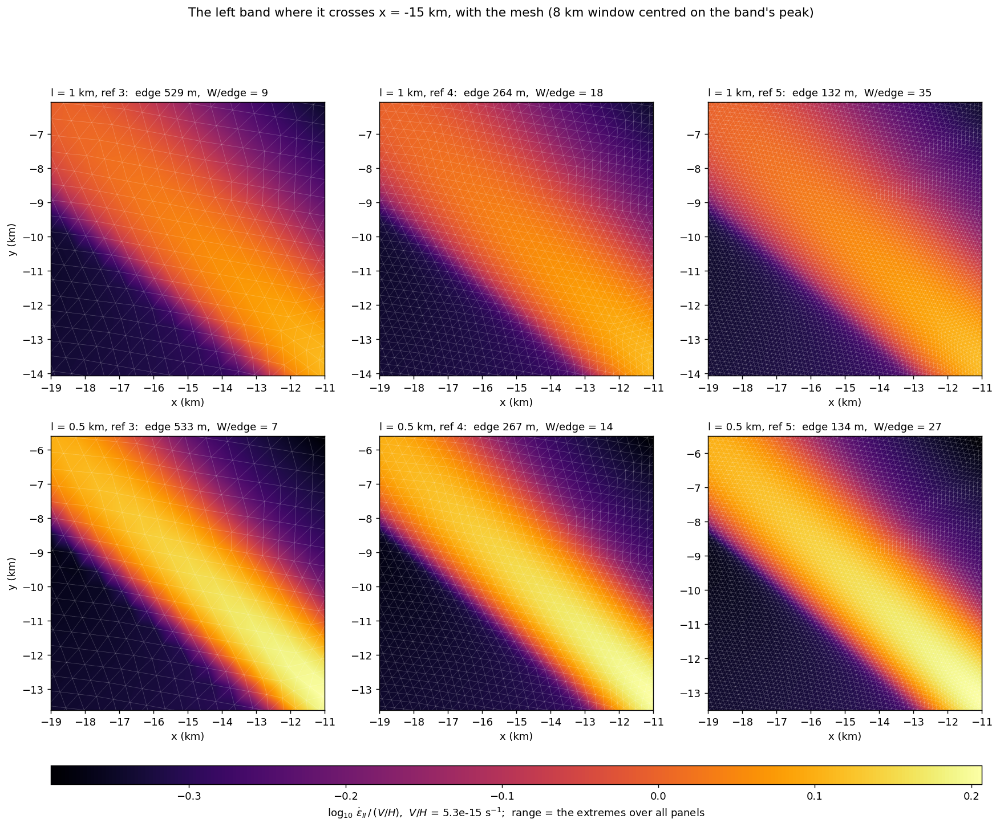
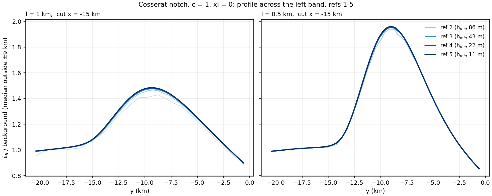
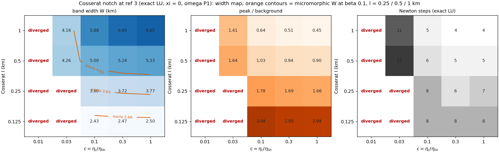
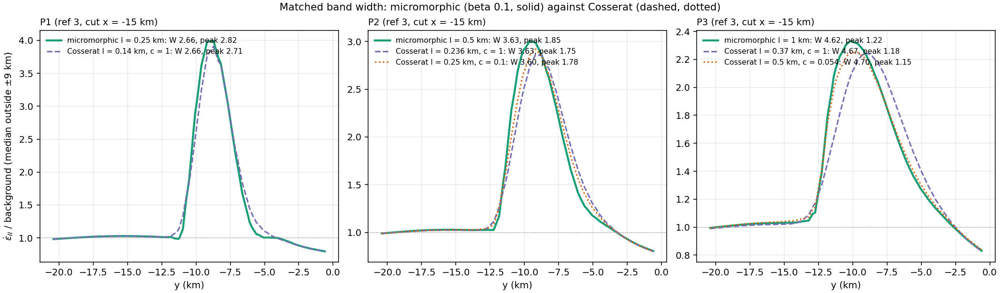
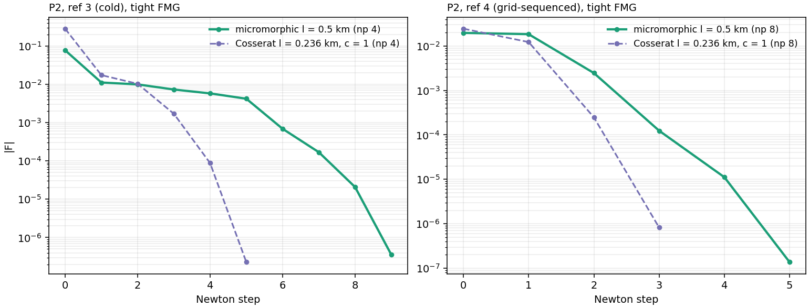
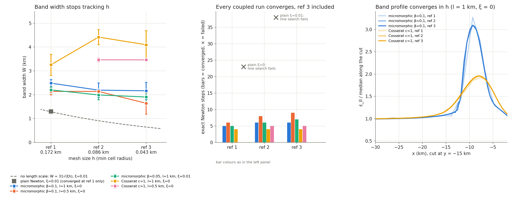
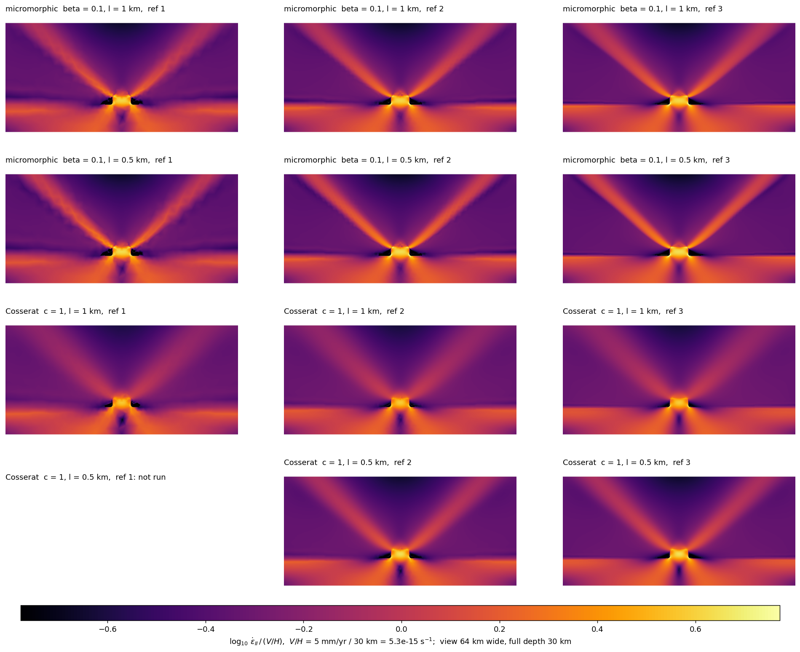
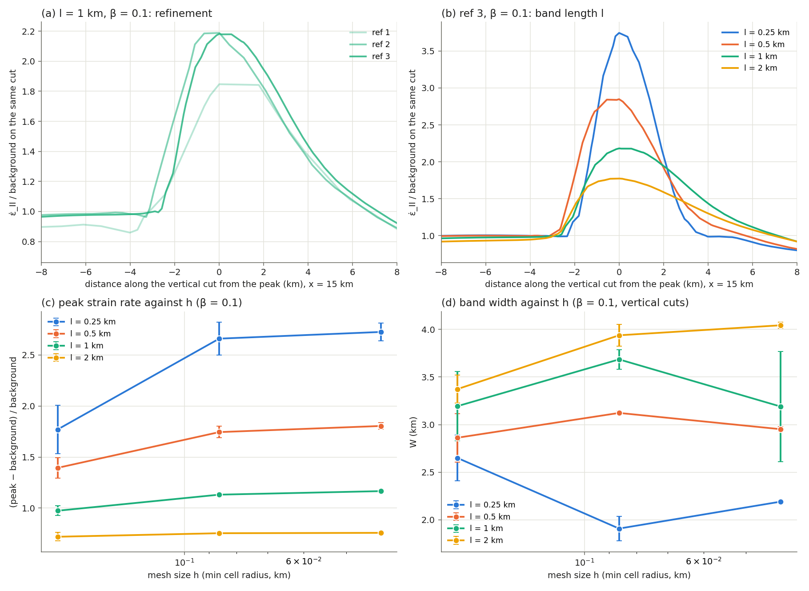

# Report: a shear-band length scale for the notch (overnight, Hyperion, 2026-10-08)

Work for `HANDOFF.md`. Code: underworld3 branch `feature/shear-band-length-scale`.
Drivers in `drivers/`, raw results in `results/` (not in git). All runs used the `dev`
environment (conda-forge PETSc), at most 4 processes, while the convection runs held the
machine (load average ~48).

## Status

| Step | State |
|---|---|
| 1. Coupled volume fields in `SNES_Stokes_SaddlePt` | done: tests pass, ordinary Stokes byte-identical |
| 2. Micromorphic coupling on the notch | done for the first matrix: ref 3 converges with NO rate strengthening (ξ = 0) at β = 0.1, l = 1 km, in 6 exact Newton steps; W stops shrinking with h |
| 3. 2-D Cosserat | done through ref 5 (2026-10-10): converges with ξ = 0 in 3-5 steps; W mesh-independent, 5.34 km at l = 0.5 and 6.69 km at l = 1 (current estimator), about 45% wider and 2-2.7× weaker in peak than micromorphic at the same l |

## Read this first (2026-10-10, refs 1-5)

**Micromorphic: the band width is mesh-independent through refinement 5 (h_min = 11 m).**
- W is the integral width: the area of ε̇_II above background within ±6 km of the
  peak, over the peak height, perpendicular to a 37.5° dip, as the median of 8
  vertical cuts.
- At β = 0.1, ξ = 0, W at refs 3, 4, 5 is 4.26, 4.26, 4.26 km at l = 1 km and
  3.40, 3.39, 3.39 km at l = 0.5 km. The peak changes by under 1% from ref 4 to 5.
  Ref 3 → 4 also holds at l = 0.25 km (2.45 → 2.44) and l = 2 km (4.49 → 4.52).
- Newton takes 5 steps at refs 4 and 5 (tight FMG, grid-sequenced). The Krylov count
  per step does not grow with h: 37-39 at ref 4 and 24-47 at ref 5 on 16 ranks.
- The residual-strength floor never engages: the bound is ≥ 24× the floor in every run.

Cells are **W (km) / peak over background (Newton steps)**; h_min = 172, 86, 43, 21, 11 m
at refs 1-5. Ref 5 ran on 16 ranks, grid-sequenced from ref 4 (tight FMG, 24-47 Krylov
iterations per Newton step). † inexact Newton (Eisenstat–Walker): at l = 0.25 km the
tight linear solve stagnates near 3e-8 relative, with more than 100 Krylov iterations.

| ξ | β | l (km) | ref 1 | ref 2 | ref 3 | ref 4 | ref 5 | last ratio W / peak | floor bound / s_min |
|---|---|---|---|---|---|---|---|---|---|
| 0 | 0.05 | 0.5 | 3.57 / 1.75 (8) | — | — | — | — | — | 63 |
| 0 | 0.05 | 1 | 3.91 / 1.40 (7) | 3.26 / 1.80 (12) | — | — | — | 1.20 / 0.78 (ref 1→2) | 64 |
| 0 | 0.1 | 0.25 | 3.55 / 1.77 (8) | 2.59 / 2.66 (10) | 2.45 / 2.72 (12) | 2.44 / 2.77 (13)† | — | 1.00 / 1.02 (ref 3→4) | 41 |
| 0 | 0.1 | 0.5 | 3.82 / 1.39 (6) | 3.45 / 1.74 (8) | 3.40 / 1.80 (9) | 3.39 / 1.82 (5) | 3.39 / 1.83 (5) | 1.00 / 1.00 (ref 4→5) | 50 |
| 0 | 0.1 | 1 | 4.28 / 0.97 (5) | 4.27 / 1.13 (6) | 4.26 / 1.17 (6) | 4.26 / 1.18 (5) | 4.26 / 1.18 (5) | 1.00 / 1.00 (ref 4→5) | 55 |
| 0 | 0.1 | 2 | 4.10 / 0.72 (5) | 4.36 / 0.75 (5) | 4.49 / 0.76 (6) | 4.52 / 0.76 (5) | — | 1.00 / 0.99 (ref 3→4) | 58 |
| 0 | 0.2 | 0.5 | 4.05 / 1.05 (5) | 4.07 / 1.25 (6) | 4.03 / 1.29 (6) | — | — | 1.01 / 0.97 (ref 2→3) | 24 |
| 0 | 0.2 | 1 | 4.58 / 0.63 (5) | 4.64 / 0.69 (5) | 4.67 / 0.71 (5) | — | — | 0.99 / 0.98 (ref 2→3) | 37 |
| 0.01 | 0.01 | 1 | 3.38 / 1.37 (7) | — | — | — | — | — | 74 |
| 0.01 | 0.05 | 0.5 | 3.81 / 1.13 (6) | 3.11 / 1.47 (8) | 3.02 / 1.52 (10) | — | — | 1.03 / 0.96 (ref 2→3) | 65 |
| 0.01 | 0.05 | 1 | 3.86 / 0.94 (5) | 3.46 / 1.13 (6) | 3.60 / 1.14 (7) | — | — | 0.96 / 0.99 (ref 2→3) | 66 |
| 0.01 | 0.1 | 1 | — | 4.28 / 0.77 (5) | 4.28 / 0.78 (5) | — | — | 1.00 / 0.99 (ref 2→3) | 59 |
| 0.05 | 0.1 | 1 | — | 4.18 / 0.23 (4) | 4.18 / 0.23 (4) | — | — | 1.00 / 0.98 (ref 2→3) | 70 |

**Figures for refs 1-5** (from checkpoints, no re-solve; β = 0.1, ξ = 0):

- **Strain-rate maps**, refs 3 / 4 / 5, l = 1 and 0.5 km, one log colour scale:
  [`refinement_maps.png`](https://github.com/lmoresi/uw3-campaigns/blob/main/notch_length_scale/figures/refinement_maps.png).
- **Mesh zoom**: a 4 km window on the left band at x = −15 km, with the mesh drawn and
  the cells across the band counted:
  [`refinement_zoom.png`](https://github.com/lmoresi/uw3-campaigns/blob/main/notch_length_scale/figures/refinement_zoom.png).
- **Profiles across the left band**, x = −15 km, refs 1-5 overlaid, over the outside
  background: [`refinement_profiles.png`](https://github.com/lmoresi/uw3-campaigns/blob/main/notch_length_scale/figures/refinement_profiles.png).
  Ref 1 is under-resolved; refs 2-5 lie on one curve.
- **W and peak against h**, every l, with the current estimator (integral width,
  background = median outside ±9 km): [`width_peak_vs_h.png`](https://github.com/lmoresi/uw3-campaigns/blob/main/notch_length_scale/figures/width_peak_vs_h.png).
  Numbers are in `results/current_widths.json` (`drivers/measure_current.py`). W at
  refs 3 / 4 / 5 is 2.66 / 2.67 / — km at l = 0.25, 3.63 / 3.63 / 3.64 at l = 0.5,
  4.62 / 4.64 / 4.64 at l = 1, and 5.42 / 5.44 / — at l = 2. At l = 2 km the peak by
  this background is noisy (0.94, 0.88, 0.95 at refs 2-4): only a few km of the cut
  lie outside the window. The whole-cut background gives 0.75, 0.76, 0.76.

In the zoom, the band at x = −15 km is crossed by elements of 530, 265 and 132 m at
refs 3, 4 and 5: 9, 18 and 35 cells across W at l = 1 km, and 7, 14 and 27 at
l = 0.5 km. h_min (43, 21, 11 m) is reached only at the notch tip. In the maps, a few
vertices at the weak inclusion's corners evaluate to ε̇_II ≤ 0 on the rebuilt model
(40 at ref 3, 2 at ref 4, none at ref 5). They are drawn grey and kept out of the colour range.
The width cuts at |x| = 12-21 km never touch them.

**FMG cost against refinement: is the band physically scaled?** (`drivers/fmg_table.py`,
`results/fmg_table.json`)

Krylov iterations per Newton step, with every linear solve to rtol 1e-8 (no
Eisenstat–Walker) under the production preconditioner: Schur fieldsplit, with
geometric FMG on [u, coupled field] over the whole hierarchy, level 0 (the base mesh)
to the run's refinement.
- h is the band-crossing element at x = −15 km; on FMG level k it is about
  4.24 km / 2^k.
- W is the integral width (background outside ±9 km).
- \* marks a step that stopped on the absolute tolerance (late, small residual);
  "(cap)" marks a solve that hit the 500-iteration cap.
- Refs 1-3 start cold from the viscous seed. Refs 4-5 are grid-sequenced from the
  ref below, so they have fewer and easier steps. Compare the medians within a
  start type.
- The plain law is the notch law with no micromorphic field, regularised by
  ξ = 0.03 alone.
- Runs at np 4 (refs 1-3), np 1 (micromorphic ref 4), np 8 (Cosserat ref 4) and
  np 16 (ref 5).

| model | ref | h in band (m) | W (km) | W / h | coarsest level with W ≥ 2h | Krylov per Newton step | median / max | outcome |
|---|---|---|---|---|---|---|---|---|
| Cosserat, l = 0.5 km | 1 | 2120 | — | — | — | 35, 37, 36, 35, 29* | 35 / 37 | CONVERGED_FNORM_ABS (5) |
| Cosserat, l = 0.5 km | 2 | 1060 | 5.33 | 5 | 1 (2120 m) | 34, 37, 36, 36, 30* | 36 / 37 | CONVERGED_FNORM_ABS (5) |
| Cosserat, l = 0.5 km | 3 | 530 | 5.33 | 10 | 1 (2120 m) | 31, 36, 36, 35, 25* | 35 / 36 | CONVERGED_FNORM_ABS (5) |
| Cosserat, l = 0.5 km | 4 | 265 | 5.34 | 20 | 1 (2120 m) | 38, 31, 32 | 32 / 38 | CONVERGED_FNORM_ABS (3) |
| Cosserat, l = 0.5 km | 5 | 132 | 5.34 | 40 | 1 (2120 m) | 38, 28, 26, 18* | 27 / 38 | CONVERGED_FNORM_ABS (4) |
| Cosserat, l = 1 km | 1 | 2120 | 6.61 | 3 | 1 (2120 m) | 34, 36, 36, 35* | 36 / 36 | CONVERGED_FNORM_ABS (4) |
| Cosserat, l = 1 km | 2 | 1060 | 6.63 | 6 | 1 (2120 m) | 33, 35, 36, 34* | 34 / 36 | CONVERGED_FNORM_ABS (4) |
| Cosserat, l = 1 km | 3 | 530 | 6.65 | 13 | 1 (2120 m) | 33, 35, 35, 33* | 34 / 35 | CONVERGED_FNORM_ABS (4) |
| Cosserat, l = 1 km | 4 | 265 | 6.68 | 25 | 1 (2120 m) | 39, 32, 30* | 32 / 39 | CONVERGED_FNORM_ABS (3) |
| Cosserat, l = 1 km | 5 | 132 | 6.69 | 50 | 1 (2120 m) | 39, 49, 47 | 47 / 49 | CONVERGED_FNORM_ABS (3) |
| micromorphic, l = 0.25 km | 1 | 2120 | 3.69 | 2 | none | 37, 52, 52, 48, 42, 43, 43, 39* | 43 / 52 | CONVERGED_FNORM_ABS (8) |
| micromorphic, l = 0.25 km | 2 | 1060 | 2.83 | 3 | 2 (1060 m) | 38, 188, 138, 99, 84, 63, 60, 63, 61, 58* | 63 / 188 | CONVERGED_FNORM_ABS (10) |
| micromorphic, l = 0.25 km | 3 | 530 | 2.66 | 5 | 2 (1060 m) | 37 | 37 / 37 | killed: the next linear solve gave no output for 1 h (None) |
| micromorphic, l = 0.5 km | 1 | 2120 | 4.12 | 2 | none | 36, 43, 43, 38, 40, 35* | 39 / 43 | CONVERGED_FNORM_ABS (6) |
| micromorphic, l = 0.5 km | 2 | 1060 | 3.64 | 3 | 2 (1060 m) | 37, 63, 64, 60, 47, 48, 50, 44* | 49 / 64 | CONVERGED_FNORM_ABS (8) |
| micromorphic, l = 0.5 km | 3 | 530 | 3.63 | 7 | 2 (1060 m) | 35, 88, 87, 80, 70, 49, 53, 54, 51* | 54 / 88 | CONVERGED_FNORM_ABS (9) |
| micromorphic, l = 0.5 km | 4 | 265 | 3.63 | 14 | 2 (1060 m) | 51, 34, 33, 33*, 27* | 33 / 51 | CONVERGED_FNORM_ABS (5) |
| micromorphic, l = 0.5 km | 5 | 132 | 3.64 | 27 | 2 (1060 m) | 47, 43, 37, 36*, 28* | 37 / 47 | CONVERGED_FNORM_ABS (5) |
| micromorphic, l = 1 km | 1 | 2120 | 5.00 | 2 | 1 (2120 m) | 32, 37, 35, 36, 36* | 36 / 37 | CONVERGED_FNORM_ABS (5) |
| micromorphic, l = 1 km | 2 | 1060 | 4.61 | 4 | 1 (2120 m) | 33, 44, 36, 37, 38, 34* | 36 / 44 | CONVERGED_FNORM_ABS (6) |
| micromorphic, l = 1 km | 3 | 530 | 4.62 | 9 | 1 (2120 m) | 29, 43, 43, 36, 36, 29* | 36 / 43 | CONVERGED_FNORM_ABS (6) |
| micromorphic, l = 1 km | 4 | 265 | 4.64 | 17 | 1 (2120 m) | 39, 27, 27, 31*, 25* | 27 / 39 | CONVERGED_FNORM_ABS (5) |
| micromorphic, l = 1 km | 5 | 132 | 4.64 | 35 | 1 (2120 m) | 38, 35, 29, 32*, 24* | 32 / 38 | CONVERGED_FNORM_ABS (5) |
| micromorphic, l = 2 km | 1 | 2120 | 5.18 | 2 | 1 (2120 m) | 34, 36, 34, 34, 31* | 34 / 36 | CONVERGED_FNORM_ABS (5) |
| micromorphic, l = 2 km | 2 | 1060 | 5.33 | 5 | 1 (2120 m) | 35, 37, 36, 36, 32* | 36 / 37 | CONVERGED_FNORM_ABS (5) |
| micromorphic, l = 2 km | 3 | 530 | 5.42 | 10 | 1 (2120 m) | 34, 38, 36, 33, 32*, 19* | 34 / 38 | CONVERGED_FNORM_ABS (6) |
| micromorphic, l = 2 km | 4 | 265 | 5.44 | 21 | 1 (2120 m) | 37, 27, 25, 30*, 21* | 27 / 37 | CONVERGED_FNORM_ABS (5) |
| plain, ξ = 0.03 | 1 | 2120 | 4.43 | 2 | 1 (2120 m) | 35, 38, 36, 35, 30* | 35 / 38 | CONVERGED_FNORM_ABS (5) |
| plain, ξ = 0.03 | 2 | 1060 | 3.92 | 4 | 2 (1060 m) | 37, 50, 50, 48, 46, 33* | 47 / 50 | CONVERGED_FNORM_ABS (6) |
| plain, ξ = 0.03 | 3 | 530 | — | — | — | 36, 226, 500(cap) | 226 / 500 | DIVERGED_LINEAR_SOLVE (2) |

What it shows:
- **A length scale keeps FMG flat when W is resolved on the coarse levels.**
  - Micromorphic at l = 1 and 2 km: 34-36 iterations per step at refs 1-3 (cold),
    and 27-32 at refs 4-5 (sequenced), with W ≥ 2h from FMG level 1 up.
  - Cosserat: 34-36 at refs 1-3 at both l, and 27-32 at refs 4-5, except l = 1 km
    at ref 5 with 39, 49, 47. That run was at np 16 against np 8 at ref 4, and the
    parallel FMG ran slightly weaker before (np 4: 227 against 216 Krylov in
    total at ref 3). One point, not a trend yet.
- **Where W approaches the coarse levels' h, the count grows.**
  - Micromorphic l = 0.5 km, cold: medians 39, 49, 54 at refs 1-3, with step maxima
    of 43, 64, 88.
  - Micromorphic l = 0.25 km: 43, then 63 (one step at 188). At ref 3 the second
    step's linear solve did not finish in an hour. The earlier probe of this case
    shows the outer Krylov stagnating near 2e-8 past 130 iterations.
- **The plain law is the control.** Its count grows with h and then fails: 35 and 47
  at refs 1-2, then 226 at step 2 and the 500 cap at step 3 at ref 3, so the
  linear solve fails (DIVERGED_LINEAR_SOLVE). Its band narrows with h (W 4.43 →
  3.92 km at refs 1 → 2) instead of converging.

So FMG performance is itself evidence that the micromorphic and Cosserat bands are
physically scaled: the solver's work per Newton step is h-independent exactly where
W is resolved on the coarse levels, and grows without bound for the law with no
length.

**3-D unit-cube damping and a NaN in the blended tangent** (2026-10-11, test_1070 setup).
- **Damping:** the 3-D default-solver case takes 20 Newton steps against 7 in 2-D, with an
  identical residual history under exact LU, tight fieldsplit (rtol 1e-8, no
  Eisenstat–Walker) and the default. It is nonlinear globalization, not loose
  linear directions: the bt line search sits at its floor λ = 0.1 for about 12 steps
  because the full step overshoots, and 2-D does the same for 4 steps. Tight linear
  solves will not remove it on the 3-D notch.
- **Bug (branch, not yet fixed):** any explicit Picard warm-up (`solve(picard=n)`) or
  `consistent_jacobian = "continuation"` fails its first linear solve when a coupled
  field's source contains the raw invariant ε̇_II = √(…). The blended tangent
  J_P + α(J_N − J_P) evaluates J_N, whose ∂ε̇_II/∂∇u is 0/0 at ∇u = 0, and α·NaN is
  NaN at α = 0. Result: GAMG sub-PC failure, or LU failure. Plain Stokes with
  η = 1 + 0.5 ε̇_II² is unaffected (no square root). With the source regularised as
  √(ε̇_II² + 1e-12), picard = 1 and picard = 3 both converge in 7 steps. The default
  path works only because it skips the warm-up here. The campaign's notch runs start
  from a viscous seed with ∇u ≠ 0 and are unaffected.

**Window and background dependence** (`drivers/window_check.py`, `results/window_check.json`).
- The window does not cap W. Widening it from ±6 km to the whole 20 km cut changes W
  by at most 1% (4.49 → 4.54 km at l = 2 km).
- The background does matter at large l. The whole-cut median sits inside the band's
  broad tails: at l = 2 km the cut ends lie 11–14% of the peak below it, against
  3–4% at l = 1 km.
- With the background taken outside a ±9 km window, W = 3.63, 4.62, 5.42 km at
  l = 0.5, 1, 2 km (ref 3), against 3.40, 4.26, 4.49 km in the table: +7%, +8%, +19%.
- Mesh independence holds under every variant. With the outside background, W at
  refs 3, 4, 5 is 3.63, 3.63, 3.64 km at l = 0.5 km and 4.62, 4.64, 4.64 km at
  l = 1 km. At l = 2 km, refs 3 and 4 give 5.42 and 5.44 km.

What sets the band:
- **l sets the width.** At ref 3, β = 0.1, ξ = 0: W = 2.45, 3.40, 4.26, 4.49 km at
  l = 0.25, 0.5, 1, 2 km. W rises steeply up to l ≈ 1 km and flattens beyond. Part
  of that flattening is the estimator: with the background taken from outside the
  band, W grows by ×1.27 and ×1.17 per doubling of l from 0.5 to 2 km, not ×1.25 and
  ×1.05. W(l) is sublinear, but it does not saturate by l = 2 km. A whole-domain
  cut, or a background fixed in the far field, is needed before the plateau is
  attributed to the notch.
- **β widens it a little.** At l = 1 km, W = 4.26 → 4.67 km for β = 0.1 → 0.2. β must
  exceed a threshold to regularise at all: β = 0.05 fails at ref 3 with ξ = 0.
- **ξ sets the intensity, not the width.** At β = 0.1, l = 1 km, ξ = 0, 0.01, 0.05 give
  W = 4.26, 4.28, 4.18 km but peaks of 1.17, 0.78, 0.23: rate strengthening flattens
  the contrast across a band whose width l has already fixed.
- **ξ and β add below threshold, but ξ counts for more.** β = 0.05 with ξ = 0.01
  converges at ref 3, where β = 0.05 alone does not. The β–ξ map below shows that
  (β + 2ξ) is not the controlling combination: ξ also stiffens the long wavelengths,
  where the micromorphic coupling vanishes.

### Which parameters are needed: the β–ξ map at ref 3 (2026-10-09)

32 runs, β ∈ {0.06, 0.07, 0.08, 0.1} × ξ ∈ {0, 0.005, 0.01, 0.02} × l ∈ {1, 0.5} km,
exact Newton (LU linear solves), ref 3. Figure:
[`figures/beta_xi_map.png`](https://github.com/lmoresi/uw3-campaigns/blob/main/notch_length_scale/figures/beta_xi_map.png);
numbers in `results/beta_xi_map.json` (`drivers/plot_beta_xi_map.py`).

- **ξ is not needed for convergence.** With ξ = 0, every β ≥ 0.06 converges at
  l = 1 km and every β ≥ 0.08 at l = 0.5 km. The threshold in β rises as l falls:
  0.05–0.06 at l = 1 km, 0.07–0.08 at l = 0.5 km. A smaller band needs a stiffer
  micro-continuum.
- **A little ξ removes the threshold.** ξ = 0.005 makes every β ≥ 0.06 converge at
  l = 0.5 km. ξ = 0.02 gives 5 Newton steps in every cell.
- **ξ buys more convergence than its share of β + 2ξ.** At l = 0.5 km, β = 0.06,
  ξ = 0.005 (β + 2ξ = 0.07) converges in 12 steps, while β = 0.07, ξ = 0 diverges.
- **Near threshold, Newton steps fall fast with ξ.** At β = 0.06, l = 1 km:
  13, 8, 6, 5 steps for ξ = 0, 0.005, 0.01, 0.02.
- **Width: l first, then β, then ξ.**
  - At l = 1 km, β = 0.1, ξ = 0 → 0.02 changes W by 1% (4.26 → 4.31 km).
  - At β = 0.06, ξ widens the band more: +11% at l = 1 km (3.61 → 4.00 km) and +16% at
    l = 0.5 km (3.02 → 3.50 km).
  - β = 0.06 → 0.1 widens it by 18% at l = 1 km.
- **ξ lowers the peak.** ξ = 0 → 0.02 lowers the peak over background by a factor of
  2–3 in every row, for example 1.61 → 0.68 at β = 0.06, l = 1 km.
- **Floor bound, not the strength shift.** The largest H χ is at most 1.01 C, and the
  floor bound is ≥ 47 s_min, so the microstructure never drives the yield stress to
  the floor.
  - H χ bounds how far the micromorphic term can LOWER σ_y: since e ≥ 0, the shift
    s ≥ −H χ.
  - It is not the strengthening. The shift the yield law feels is s = m H (e − χ):
    positive at the band centre, negative on the flanks.
  - Its max and min over the strong layer are tabulated separately
    (`drivers/shift_stats.py`).
  - (Corrected 2026-10-12: an earlier note called max H χ "the strength shift".)

So the cheapest regularisation that leaves the band intensity alone is ξ = 0 with β
just above threshold for the chosen l. Adding ξ ≈ 0.005–0.01 halves the Newton steps
near threshold and changes W by under 10%, but it already lowers the peak by
20–40%. Caveat: ref 3 only. Near threshold the width still moved between refs
(β = 0.05, l = 1 km: 3.91 → 3.26 km at refs 1 → 2), so the low-β cells need a ref-4
check before W is quoted from them.

**Cosserat (2-D, c = 1, ω in P1, ξ = 0), refs 1-5** (2026-10-10; current estimator:
integral width, background outside ±9 km; `results/current_widths_cosserat.json`).
- l = 1 km: W = 6.61, 6.63, 6.65, 6.68, 6.69 km at refs 1-5; peak 0.41, 0.44, 0.45,
  0.45, 0.46.
- l = 0.5 km: W = 5.33, 5.33, 5.34, 5.34 km at refs 2-5; peak 0.88, 0.90, 0.91, 0.92.
- Refs 4 and 5 are tight FMG, grid-sequenced from the ref below (np 8 and np 16):
  3 Newton steps at l = 1 km and 3-4 at l = 0.5 km, 25 and 75 minutes. The
  driver's -uw_init path is new for this.

So the Cosserat band is mesh-independent through ref 5, like the micromorphic one.
By the current estimator it is **about 45% wider at the same l** (6.69 against
4.64 km at l = 1; 5.34 against 3.64 km at l = 0.5) and **2-2.7× weaker in peak**
(0.46 against 1.24; 0.92 against 1.88).
- This replaces the earlier "about 15% wider, about 4× weaker", which used the
  whole-cut background. That background biases broad bands the most (see the window
  check above).
- The "twice as wide" stated further down came from the horizontal-cut estimator
  and stays withdrawn.
- W is insensitive to c (0.5 or 1), to the degree of ω, and to ξ, which again lowers
  only the peak (refs 1-3, whole-cut background).

Figures:
[`refinement_maps_cosserat.png`](https://github.com/lmoresi/uw3-campaigns/blob/main/notch_length_scale/figures/refinement_maps_cosserat.png),
[`refinement_zoom_cosserat.png`](https://github.com/lmoresi/uw3-campaigns/blob/main/notch_length_scale/figures/refinement_zoom_cosserat.png),
[`refinement_profiles_cosserat.png`](https://github.com/lmoresi/uw3-campaigns/blob/main/notch_length_scale/figures/refinement_profiles_cosserat.png). Cosserat is
also overlaid (dashed) on [`width_peak_vs_h.png`](https://github.com/lmoresi/uw3-campaigns/blob/main/notch_length_scale/figures/width_peak_vs_h.png).

### Cosserat parameter space (ref 3, 2026-10-11)

W(l, c) at ref 3 with exact LU, ξ = 0, ω in P1, current estimator
(`drivers/plot_cosserat_map.py`, `results/cosserat_width_map.json`):

- **Cosserat has its own convergence threshold, in c = η_c/η_lin.**
  - c = 0.01 never converges.
  - c = 0.03 converges only at l ≥ 0.5 km.
  - c ≥ 0.1 converges everywhere.
  - The minimum c rises as l falls, as β's threshold does for micromorphic.
- **W is set by l first, then by c.**
  - At c = 1, W = 2.50, 3.77, 5.33, 6.65 km for l = 0.125, 0.25, 0.5, 1 km.
  - Small c narrows the band, steeply near the threshold: at l = 1 km, W = 6.65, 5.88,
    4.16 km for c = 1, 0.1, 0.03.
- **Newton steps (exact LU):** 4-8 wherever c ≥ 0.1, and 11-12 at c = 0.03.

### 3-D: the extruded notch (2026-10-12)

**Setup.**
- The notch is extruded along strike: `drivers/make_notch_mesh_3d.py`, tetrahedra, with a
  Box size field grading the band region.
- Boundary conditions: the 2-D ones with u_z = 0 on the side walls, and u_z = 0 alone on
  the strike-normal faces (symmetry planes).
- Not rotated free-slip, which refuses a coupled field.
- Micromorphic β = 0.1, ξ = 0, l = 1 km, tight FMG, seeded, on the merged branch build
  (graph JIT route).

**Two blockers removed on the way.**
- **Expanded JIT route: 22 MB of C.** gcc -O1 took 39 min and 8.2 GB, and -O0 timed out at
  40 min. The graph route (tier 2, merged as a96de5b6) gives headers of at most 54 KB.
- **The first base mesh (h_band 2.4 km) had a 37k-dof coarse level.** Its redundant LU took
  about 6.5 min of every Newton step. The base is now h_band 4.8 km (1.8k tets), refined
  twice to the same 1.2 km band element, and setup takes about 75 s.

**Cost.** About 50-60 s per outer Krylov iteration at roughly 0.5M dofs on 8 ranks, about
4× 2-D per dof for P2 tets.
- A 1.2 km band element is feasible: about 2 h per run at np 8.
- 0.6 km would take most of a day at np 16.
- 0.3 km is out of reach.

**β = 0.1, band element 1.2 km** (Lz = 6 km):

| quantity | 3-D | 2-D at the same band element |
|---|---|---|
| Newton steps (seeded) | 6 | 6 (refs 2-3) |
| Krylov per Newton step | 39, 46, 40, 39, 36, 29 | 35-43 |
| W at mid-strike (km) | 4.586 | about 4.65 (interpolated: 5.00 at 2.1 km, 4.61 at 1.06 km); converged 4.62-4.64 |
| W(z), 11 planes (km) | 4.54-4.60 | — |
| peak / background | 1.18 | 1.20-1.22 |
| wall time | 1 h 53 min at np 8 | — |

- The 3-D code path reproduces 2-D: same Newton count, same W to about 1.5%, and W uniform
  along strike to ±0.7%, as the symmetry planes imply.
- FMG stays flat in 3-D: 29-46 Krylov per step against 35-43 in 2-D.
- β = 0.3 at the same resolution: 5 Newton steps (Krylov 36, 37, 37, 34, 25), W at
  mid-strike 5.684 km (5.60-5.76 along strike), peak 0.65, 1 h 17 min at np 8.
  - Against β = 0.1: one Newton step fewer, a 24% wider and weaker band, as in 2-D.
    In 2-D, β 0.1 → 0.2 at l = 1 widens W by 10% and cuts one step.
  - The strengthening it buys in the band is about 1.1 C, against 0.37 C (see the shift
    table).
**Along-strike ramp, w = 2 km** (2026-10-13).
- Setup: log10 η_b(z) = 22 − tanh((z0 − z)/w), with z0 = 8 km, w = 2 km and Lz = 16 km.
  - The z = 0 face is a symmetry plane, so the weak segment is half of a 16 km notch.
  - The z = 16 km face is also a symmetry plane, so the model is a row of 16 km notches
    separated by 16 km gaps with no inclusion (η_b = 10²³, the strong layer).
- Mesh: `notch3d_hb4.8_Lz16_z8h2.4.msh` (z-window 8 ± 4 km at 2.4 km), ref 2, so the band
  element is 1.2 km and the z-element 0.6 km in the window.
- Solver: β = 0.1, l = 1 km, tight FMG, np 16.

| z (km) | log10 η_b | W (km) | peak / background |
|---|---|---|---|
| 0.3 | 21.00 | 5.84 | 0.326 |
| 1.6 | 21.00 | 5.87 | 0.323 |
| 3.2 | 21.02 | 5.91 | 0.324 |
| 4.8 | 21.08 | 5.73 | 0.321 |
| 6.4 | 21.34 | 5.44 | 0.308 |
| 8.0 | 22.00 | 4.86 | 0.275 |
| 9.6 | 22.66 | 4.20 | 0.239 |
| 11.2 | 22.92 | 3.65 | 0.210 |
| 12.8 | 22.98 | 3.37 | 0.195 |
| 14.4 | 23.00 | 3.29 | 0.192 |
| 15.7 | 23.00 | 3.25 | 0.185 |

- ⚠️ **Confounded (2026-10-13): the ramp scales the whole Weak region, not only the
  notch.** The ramp multiplies `(1 − m_strong)`, which is the entire Weak volume: the lower
  viscous layer (y < −0.75 H) as well as the notch bump. So at the far end the whole
  substrate stiffens to 10²³. The far end is "no weak layer", not "no notch", and the
  loading changes along strike with the substrate.
  - The brief ("η_b(z)") was ambiguous, and the restricted notch Louis asked for is
    notch-only. Which was meant is with Louis.
  - Until he answers, the numbers below describe the wider reading only, the w = 4 and
    w = 1 runs are held, and the capped-EW rerun of w = 2 was stopped.
- **The band does not die in this domain.** Where there is no inclusion at all (z ≥ 12 km),
  the band keeps about 60% of the weak end's peak. It is narrower there: 3.3 km against
  5.9 km.
  - The gap between mirrored notches is only 16 km, comparable with the band's along-strike
    reach, so the two neighbouring notches carry it across.
  - Finding where it dies needs a longer Lz (32-48 km with z0 = 8).
- **A finite notch localises much less than an infinite one.** At the weak end the peak is
  0.33 against 1.18 for the uniform extrusion, and W is 5.9 km against 4.6 km.
- **Solver.**
  - 4 Newton steps from the seed: |F| 0.0118 → 2.3e-3 → 6.0e-4 → 5.0e-5 → 4.0e-7, all full
    steps, linear until the last.
  - Krylov per step: 55, 81, 78, 71, nearly twice the uniform extrusion's 29-46. The 100×
    along-strike viscosity contrast over 2 km is resolved on the fine levels only (the
    base z-element is 2.4 km), so FMG loses some of its grip.
  - Time: 8 h 13 min at np 16. Each linear solve went to rtol 1e-8, about 1.7 h per step.
    A rerun with capped Eisenstat-Walker (next section) is under way for the comparison.
- Figures: `figures/<run>_sections.png`, `_map.png` and `_alongstrike.png` once
  `drivers/render_3d_ramp.py` has run.

### The yield-stress shift the micromorphic law applies (ref 3, 2026-10-12)

The shift is s = m H (e − χ). It is positive at the band centre (strengthening) and
negative on the flanks. It is computed from the saved u and χ, with e L2-projected onto
χ's P1 space, over the strong layer (`drivers/shift_stats.py`,
`results/shift_stats_ref3.json`).
- **Band:** 9 ≤ |x| ≤ 24 km, the stretch of the limbs that the width cuts sample.
- **Global:** the whole strong layer. Its maximum sits at the notch tip, where e peaks.
- **Floor bound:** max H χ / C, a different quantity. It bounds how far s can lower σ_y
  (s ≥ −H χ), and is kept for the floor check.

| β | l (km) | band max s/C | band min s/C | global max s/C (notch tip) | floor bound max Hχ/C |
|---|---|---|---|---|---|
| 0.05 | 0.5 | 0.19 | -0.11 | 2.08 | 0.51 |
| 0.05 | 1 | 0.18 | -0.09 | 2.19 | 0.36 |
| 0.06 | 0.5 | 0.29 | -0.11 | 2.04 | 0.46 |
| 0.06 | 1 | 0.21 | -0.11 | 2.47 | 0.45 |
| 0.07 | 0.5 | 0.27 | -0.14 | 2.19 | 0.66 |
| 0.07 | 1 | 0.25 | -0.11 | 2.72 | 0.51 |
| 0.08 | 0.5 | 0.28 | -0.12 | 2.99 | 0.85 |
| 0.08 | 1 | 0.29 | -0.11 | 2.95 | 0.57 |
| 0.1 | 0.25 | 0.36 | -0.10 | 3.57 | 1.56 |
| 0.1 | 0.5 | 0.36 | -0.12 | 3.49 | 1.01 |
| 0.1 | 1 | 0.37 | -0.11 | 3.40 | 0.68 |
| 0.1 | 2 | 0.38 | -0.07 | 3.35 | 0.48 |
| 0.2 | 0.125 | 0.74 | -0.15 | 6.54 | 3.99 |
| 0.2 | 0.25 | 0.72 | -0.11 | 6.04 | 2.68 |
| 0.2 | 0.5 | 0.74 | -0.13 | 5.70 | 1.74 |
| 0.2 | 1 | 0.76 | -0.12 | 5.50 | 1.22 |
| 0.3 | 0.125 | 1.11 | -0.23 | 8.86 | 5.52 |
| 0.3 | 0.138 | 1.11 | -0.22 | 8.72 | 5.23 |
| 0.3 | 0.25 | 1.10 | -0.14 | 8.21 | 3.64 |
| 0.3 | 0.272 | 1.10 | -0.13 | 8.14 | 3.46 |
| 0.3 | 0.5 | 1.13 | -0.14 | 7.70 | 2.39 |
| 1 | 0.125 | 3.84 | -0.79 | 25.05 | 13.73 |
| 1 | 0.148 | 3.86 | -0.74 | 24.80 | 12.39 |
| 1 | 0.25 | 3.92 | -0.51 | 23.75 | 8.90 |
| 1 | 0.5 | 4.08 | -0.16 | 21.74 | 6.28 |

- **In the band the strengthening grows linearly with β and hardly depends on l:**
  max s ≈ 3.7 β C. That is 0.37 C at β = 0.1, 0.75 C at β = 0.2, 1.1 C at β = 0.3 and
  3.9 C at β = 1.
- **Weakening on the band's flanks is small:** −0.1 to −0.2 C for β ≤ 0.3.
- **This is the number for the choice of β.** β 0.2-0.3 cuts the Newton steps at
  l = 0.5 km from 9 to 6, at the price of raising the band's yield stress by 0.75-1.1 C
  instead of 0.37 C.
- (An earlier version of this point used max H χ, which is the floor bound and not the
  shift. A point evaluate of `Unknowns.Einv2` cannot be used here: on a model with
  another unit-ful variable it returns e rescaled to the borrowed units, underworld3
  #843. The widths and peaks are ratios and unaffected.)

### Matched-width comparison: micromorphic against Cosserat

Cosserat (l, c) settings chosen from the map to give the micromorphic (β = 0.1) widths
at ref 3, then confirmed by exact runs (W at ref 3):

| pair | micromorphic | W | Cosserat | W | peak micro / Cosserat |
|---|---|---|---|---|---|
| P1 | l = 0.25 km | 2.655 | l = 0.14 km, c = 1 | 2.658 | 2.82 / 2.71 |
| P2 | l = 0.5 km | 3.625 | l = 0.236 km, c = 1 | 3.633 | 1.85 / 1.75 |
| P2 | | | l = 0.25 km, c = 0.1 | 3.598 | 1.85 / 1.78 |
| P3 | l = 1 km | 4.617 | l = 0.37 km, c = 1 | 4.669 | 1.22 / 1.18 |
| P3 | | | l = 0.5 km, c = 0.054 | 4.702 | 1.22 / 1.15 |

(l = 1 km, c = 0.041 missed, at 5.15 km: W is steep in c near the threshold.)

- **At matched width the band shapes and peaks agree, but the c = 1 band sits higher.**
  - Peaks agree within 3-6%, and the micromorphic lower flank is slightly steeper.
  - The peak's y on each of the 8 cuts (`drivers/peak_positions.py`,
    `results/peak_positions.json`) gives the same dip for both models: 43-45° for the peak
    trace, against 45.0 / 45.1° micromorphic at P3.
  - But the Cosserat c = 1 trace is shifted upward on every cut at P3: by about 1 km
    (y = −9.17 against −10.06 km at x = −15 km; intercept at x = 0, −23.9 against
    −25.1 km).
  - At P2 there is no systematic offset. Micromorphic l = 0.5 km is itself 1 km
    left/right asymmetric (intercepts −24.5 / −23.5 km). The Cosserat differences
    (c = 1: +0.6 / −0.5; c = 0.1: +1.2 / +0.1) have no consistent sign and lie within
    that scatter.
  - The left/right asymmetry of a symmetric notch is itself an open point. The peak y
    is quantised to the nodes on each cut (steps of about 0.1-0.5 km), which is part of
    it. Whether the rest is a genuinely one-sided solution has not been checked.
  - The small-c Cosserat bands, (0.25, 0.1) and (0.5, 0.054), follow the micromorphic
    trace to within about 0.3 km.
  - So at c = 1 the band is the same width and dip but rooted about 1 km higher on the
    notch. Near the threshold in c, Cosserat reproduces the micromorphic band, position
    included.
  - Profiles: [`matched_profiles_ref3.png`](https://github.com/lmoresi/uw3-campaigns/blob/main/notch_length_scale/figures/matched_profiles_ref3.png),
    [`matched_profiles_ref4.png`](https://github.com/lmoresi/uw3-campaigns/blob/main/notch_length_scale/figures/matched_profiles_ref4.png).
- **Mesh independence of the matched Cosserat runs**, W at refs 3 → 4:
  - 2.658 → 2.600 (P1);
  - 3.633 → 3.622 and 3.598 → 3.607 (P2);
  - 4.669 → 4.674 and 4.702 → 4.696 (P3).
  - At ref 4, micromorphic l = 0.5 and 1 km give 3.632 and 4.635.
  - P1 moves 2%, the rest under 0.3%.

**Solver efficiency on the pairs.** Tight FMG (rtol 1e-8, no Eisenstat–Walker).
- Refs 1-3 at np 4 start from the viscous seed, so they take no Picard warm-up
  ("0 + N"; the seed solve is not counted, and it is the same for both models).
- Ref 4 at np 8 is grid-sequenced from the exact ref-3 run.
- s per Newton step is wall time under a shared machine (load about 40), so it
  compares within a row's np only roughly.
- (`drivers/eff_table.py`, `results/eff_table.json`)

| pair | model | ref (np) | Newton | Krylov / step median / max | s per Newton step | W (km) | peak | outcome |
|---|---|---|---|---|---|---|---|---|
| P1 | micromorphic l = 0.25 | 1 (4) | 8 | 43 / 52 | 24 | 3.69 | 1.85 | CONVERGED_FNORM_ABS |
| P1 | micromorphic l = 0.25 | 2 (4) | 10 | 63 / 188 | 173 | 2.83 | 2.67 | CONVERGED_FNORM_ABS |
| P1 | micromorphic l = 0.25 | 3 (None) | None | 37 / 37 | — | — | — | killed |
| P1 | micromorphic l = 0.25 | 4 (None) | None | — | — | — | — | killed |
| P1 | Cosserat l = 0.14, c = 1 | 1 (4) | 7 | 43 / 46 | 29 | 4.41 | 1.58 | CONVERGED_FNORM_ABS |
| P1 | Cosserat l = 0.14, c = 1 | 2 (4) | 10 | 51 / 67 | 195 | 3.06 | 2.41 | CONVERGED_FNORM_ABS |
| P1 | Cosserat l = 0.14, c = 1 | 3 (4) | 9 | 63 / 84 | 1068 | 2.66 | 2.71 | CONVERGED_FNORM_ABS |
| P1 | Cosserat l = 0.14, c = 1 | 4 (8) | 4 | 57 / 61 | 1651 | 2.60 | 2.76 | CONVERGED_FNORM_ABS |
| P2 | micromorphic l = 0.5 | 1 (4) | 6 | 39 / 43 | 25 | 4.12 | 1.44 | CONVERGED_FNORM_ABS |
| P2 | micromorphic l = 0.5 | 2 (4) | 8 | 49 / 64 | 95 | 3.64 | 1.80 | CONVERGED_FNORM_ABS |
| P2 | micromorphic l = 0.5 | 3 (4) | 9 | 54 / 88 | 560 | 3.63 | 1.85 | CONVERGED_FNORM_ABS |
| P2 | micromorphic l = 0.5 | 4 (8) | 5 | 35 / 51 | 768 | 3.63 | 1.88 | CONVERGED_FNORM_ABS |
| P2 | Cosserat l = 0.236, c = 1 | 1 (4) | 6 | 38 / 41 | 25 | 4.68 | 1.32 | CONVERGED_FNORM_ABS |
| P2 | Cosserat l = 0.236, c = 1 | 2 (4) | 6 | 44 / 48 | 126 | 3.77 | 1.66 | CONVERGED_FNORM_ABS |
| P2 | Cosserat l = 0.236, c = 1 | 3 (4) | 5 | 45 / 48 | 473 | 3.63 | 1.75 | CONVERGED_FNORM_ABS |
| P2 | Cosserat l = 0.236, c = 1 | 4 (8) | 3 | 38 / 41 | 781 | 3.62 | 1.77 | CONVERGED_FNORM_ABS |
| P2 | Cosserat l = 0.25, c = 0.1 | 1 (4) | 6 | 39 / 42 | 43 | 4.35 | 1.40 | CONVERGED_FNORM_ABS |
| P2 | Cosserat l = 0.25, c = 0.1 | 2 (4) | 7 | 44 / 53 | 83 | 3.72 | 1.67 | CONVERGED_FNORM_ABS |
| P2 | Cosserat l = 0.25, c = 0.1 | 3 (4) | 8 | 46 / 54 | 326 | 3.60 | 1.78 | CONVERGED_FNORM_ABS |
| P2 | Cosserat l = 0.25, c = 0.1 | 4 (8) | 4 | 42 / 47 | 660 | 3.61 | 1.80 | CONVERGED_FNORM_ABS |
| P3 | micromorphic l = 1 | 1 (4) | 5 | 37 / 38 | 62 | 5.00 | 1.15 | CONVERGED_FNORM_ABS |
| P3 | micromorphic l = 1 | 2 (4) | 6 | 38 / 46 | 73 | 4.61 | 1.20 | CONVERGED_FNORM_ABS |
| P3 | micromorphic l = 1 | 3 (4) | 6 | 36 / 45 | 324 | 4.62 | 1.22 | CONVERGED_FNORM_ABS |
| P3 | micromorphic l = 1 | 4 (8) | 5 | 28 / 39 | 594 | 4.64 | 1.23 | CONVERGED_FNORM_ABS |
| P3 | Cosserat l = 0.37, c = 1 | 1 (4) | 5 | 37 / 39 | 23 | 5.12 | 1.01 | CONVERGED_FNORM_ABS |
| P3 | Cosserat l = 0.37, c = 1 | 2 (4) | 5 | 38 / 39 | 89 | 4.69 | 1.15 | CONVERGED_FNORM_ABS |
| P3 | Cosserat l = 0.37, c = 1 | 3 (4) | 5 | 37 / 38 | 294 | 4.67 | 1.18 | CONVERGED_FNORM_ABS |
| P3 | Cosserat l = 0.37, c = 1 | 4 (8) | 3 | 33 / 38 | 532 | 4.67 | 1.19 | CONVERGED_FNORM_ABS |
| P3 | Cosserat l = 0.5, c = 0.054 | 1 (4) | 6 | 36 / 38 | 40 | 5.05 | 1.00 | CONVERGED_FNORM_ABS |
| P3 | Cosserat l = 0.5, c = 0.054 | 2 (4) | 6 | 38 / 45 | 64 | 4.69 | 1.14 | CONVERGED_FNORM_ABS |
| P3 | Cosserat l = 0.5, c = 0.054 | 3 (4) | 6 | 38 / 44 | 323 | 4.70 | 1.15 | CONVERGED_FNORM_ABS |
| P3 | Cosserat l = 0.5, c = 0.054 | 4 (8) | 4 | 37 / 45 | 698 | 4.70 | 1.16 | CONVERGED_FNORM_ABS |

**Stiffer β at matched width** (2026-10-13; rows added below the pairs above, same
settings). β = 0.3 and β = 1 have l chosen to give the W of micromorphic β = 0.1 at
l = 0.25 (P1) and l = 0.5 (P2).

| pair | model | ref (np) | Newton | Krylov / step median / max | s per Newton step | W (km) | peak | outcome |
|---|---|---|---|---|---|---|---|---|
| P1 | micromorphic β = 0.3, l = 0.138 | 1 (4) | 8 | 42 / 51 | 32 | 3.94 | 1.70 | CONVERGED_FNORM_ABS |
| P1 | micromorphic β = 0.3, l = 0.138 | 2 (4) | 17 | 72 / 84 | 109 | 2.85 | 2.55 | CONVERGED_FNORM_ABS |
| P1 | micromorphic β = 0.3, l = 0.138 | 3 (4) | 17 | 155 / 254 | 973 | 2.66 | 2.69 | CONVERGED_FNORM_ABS |
| P1 | micromorphic β = 0.3, l = 0.138 | 4 (8) | 5 | 126 / 133 | 1480 | 2.65 | 2.71 | CONVERGED_FNORM_ABS |
| P2 | micromorphic β = 0.3, l = 0.272 | 1 (4) | 7 | 38 / 41 | 18 | 4.29 | 1.35 | CONVERGED_FNORM_ABS |
| P2 | micromorphic β = 0.3, l = 0.272 | 2 (4) | 8 | 45 / 53 | 61 | 3.71 | 1.63 | CONVERGED_FNORM_ABS |
| P2 | micromorphic β = 0.3, l = 0.272 | 3 (4) | 10 | 43 / 56 | 235 | 3.66 | 1.72 | CONVERGED_FNORM_ABS |
| P2 | micromorphic β = 0.3, l = 0.272 | 4 (8) | 4 | 30 / 38 | 414 | 3.67 | 1.73 | CONVERGED_FNORM_ABS |
| P2 | micromorphic β = 1, l = 0.148 | 1 (4) | 14 | 35 / 43 | 12 | 4.48 | 1.25 | CONVERGED_FNORM_ABS |
| P2 | micromorphic β = 1, l = 0.148 | 2 (4) | 22 | 40 / 50 | 56 | 3.73 | 1.54 | CONVERGED_FNORM_ABS |
| P2 | micromorphic β = 1, l = 0.148 | 3 (4) | 27 | 41 / 53 | 227 | 3.68 | 1.61 | CONVERGED_FNORM_ABS |
| P2 | micromorphic β = 1, l = 0.148 | 4 (8) | 3 | 35 / 36 | 443 | 3.68 | 1.62 | CONVERGED_FNORM_ABS |

- **Without grid sequencing, a stiffer β costs Newton steps and saves none.** Refs 1-3
  start from the viscous seed, as the β = 0.1 baseline does.
  - At P2, refs 1-3 take 7 / 8 / 10 steps at β = 0.3 and 14 / 22 / 27 at β = 1, against
    6 / 8 / 9 at β = 0.1.
  - At P1, β = 0.3 takes 17 steps at refs 2 and 3, against 10 at β = 0.1 ref 2 (ref 3 was
    not run).
- **FMG stays flat at P2 for every β:** 35-45 Krylov per step. At P1 with β = 0.3 it does
  not: 42 → 72 → 155 (median) over refs 1-3, and 126 at ref 4. That is the thinnest band
  (2.65 km) with the stiffest coupling.
- Grid sequencing removes most of that cost at ref 4 for every β: 3-5 Newton
  steps.
- The widths match by construction (P2: 3.63 / 3.67 / 3.68 km at ref 4). The peak is a
  little lower as β grows (1.88 / 1.73 / 1.62).

- **Newton:** Cosserat c = 1 takes the same number of Newton steps or fewer, at every
  pair and refinement: at P2, ref 3, 5 against 9, and at ref 4, 3 against 5 (residual
  histories: [`matched_residuals.png`](https://github.com/lmoresi/uw3-campaigns/blob/main/notch_length_scale/figures/matched_residuals.png)).
- **Krylov:** the counts per step are close, and Cosserat is slightly lower at P2.
- **P1, the narrow band:** this separates the models. Micromorphic l = 0.25 km stalls
  under tight FMG at refs 3 and 4: a linear solve gives no output for an hour and the
  supervisor kills it. The matched Cosserat (0.14, 1) converges at refs 3 and 4, with
  Krylov rising to 57-63 per step.
- **Small-c Cosserat:** (0.25, 0.1) and (0.5, 0.054) are as cheap as c = 1 from the
  seed, but see the cold starts below.

*Correction (2026-10-12):* the first version of the table above took the micromorphic
l = 0.25 and 0.5 km rows at refs 1-3 from the cold-start records, which sort first by
name. Their Newton counts included the warm-up: P2 read 8/8/10 for the seeded 6/8/9.
Fixed in `eff_table.py`; the Krylov columns were right throughout.

**Cold starts** (no viscous seed, refs 1-3, np 4). The automatic Picard warm-up arms,
so these exercise the frozen-tangent fix 0f882cc8 on the notch. Reported as
"warm-up + Newton"; the solve report folds the warm-up into nl_its and records it
as `picard_warmup_its`. (`results/eff_table_cold.json`.)

| pair | model | ref | warm-up + Newton | Krylov / step median / max | s | outcome |
|---|---|---|---|---|---|---|
| P1 | micromorphic l = 0.25 | 1 | 1 + 8 | 42 / 46 | 198 | CONVERGED_FNORM_ABS |
| P1 | micromorphic l = 0.25 | 2 | 1 + 10 | 60 / 90 | 1252 | CONVERGED_FNORM_ABS |
| P1 | micromorphic l = 0.25 | 3 | — | — | — | killed (no output for 1 h) |
| P1 | Cosserat l = 0.14, c = 1 | 1 | 1 + 7 | 42 / 43 | 219 | CONVERGED_FNORM_ABS |
| P1 | Cosserat l = 0.14, c = 1 | 2 | 1 + 9 | 49 / 63 | 2133 | CONVERGED_FNORM_ABS |
| P2 | micromorphic l = 0.5 | 1 | 1 + 7 | 38 / 40 | 166 | CONVERGED_FNORM_ABS |
| P2 | micromorphic l = 0.5 | 2 | 1 + 7 | 44 / 53 | 564 | CONVERGED_FNORM_ABS |
| P2 | micromorphic l = 0.5 | 3 | 1 + 9 | 51 / 67 | 4216 | CONVERGED_FNORM_ABS |
| P2 | Cosserat l = 0.236, c = 1 | 1 | 1 + 6 | 40 / 41 | 185 | CONVERGED_FNORM_ABS |
| P2 | Cosserat l = 0.236, c = 1 | 2 | 1 + 7 | 42 / 46 | 1191 | CONVERGED_FNORM_ABS |
| P2 | Cosserat l = 0.25, c = 0.1 | 1 | 1 + 40 | 44 / 46 | 710 | DIVERGED_MAX_IT |
| P2 | Cosserat l = 0.25, c = 0.1 | 2 | 1 + 40 | 51 / 54 | 4978 | DIVERGED_MAX_IT |
| P2 | Cosserat l = 0.25, c = 0.1 | 3 | 1 + 12 | 40 / 51 | 6104 | CONVERGED_FNORM_ABS |
| P3 | micromorphic l = 1 | 1 | 1 + 7 | 35 / 36 | 153 | CONVERGED_FNORM_ABS |
| P3 | micromorphic l = 1 | 2 | 1 + 7 | 35 / 40 | 485 | CONVERGED_FNORM_ABS |
| P3 | micromorphic l = 1 | 3 | 1 + 7 | 35 / 41 | 2392 | CONVERGED_FNORM_ABS |
| P3 | Cosserat l = 0.37, c = 1 | 1 | 1 + 6 | 38 / 39 | 164 | CONVERGED_FNORM_ABS |
| P3 | Cosserat l = 0.37, c = 1 | 2 | 1 + 6 | 38 / 39 | 820 | CONVERGED_FNORM_ABS |
| P3 | Cosserat l = 0.37, c = 1 | 3 | 1 + 6 | 36 / 37 | 4444 | CONVERGED_FNORM_ABS |
| P3 | Cosserat l = 0.5, c = 0.054 | 1 | 1 + 40 | 43 / 44 | 602 | DIVERGED_MAX_IT |
| P3 | Cosserat l = 0.5, c = 0.054 | 2 | 1 + 40 | 46 / 49 | 4347 | DIVERGED_MAX_IT |

- **Micromorphic and Cosserat c = 1** converge from cold in 1 + 6-10 steps: the
  warm-up path works on the real notch. The exception is micromorphic l = 0.25 km at
  ref 3, which stalls as it does seeded.
- **Small-c Cosserat does not converge from cold.** (0.25, 0.1) and (0.5, 0.054) reach
  the 40-step budget even at ref 1, though seeded they converge in 6-8 steps. Near
  the c threshold, Cosserat needs a good initial state.

**Summary.**
- At the same band width the two models make bands of the same width, dip and peak.
  Cosserat c = 1 roots its band about 1 km higher on the notch; small c does not.
- Cosserat c = 1 is somewhat more robust and faster in Newton, and it reaches the
  narrow-band case (P1) that stalls micromorphic's FMG. It needs l about 0.4-0.55 of
  the micromorphic l, and three fields per node instead of one extra scalar in 3-D.
- Small c buys a narrower band per unit l, at the cost of a cold-start failure.

The older widths in this report (horizontal cuts, then the 10%-support vertical
"equivalent width") jitter by ±0.5 km on these tailed profiles and are superseded by
the integral width. The parallel path agrees with serial at np = 2 (same Newton count,
widths to 9 digits). The np = 4 check at ref 3 is queued, and ref 5 (np ≤ 16) waits for
the machine.

## Summary (end of the overnight run)

1. **Plumbing works and is guarded.** `add_coupled_field` / `add_coupled_dirichlet_bc`
   on `SNES_Stokes_SaddlePt`, pushed to `feature/shear-band-length-scale` (`003d3b95`,
   `6f0627ce`). Ordinary Stokes C is byte-identical to the base. The handoff test subset
   passes (41), plus the new `test_1070` (projection identity, Taylor slope 2 with a
   failing negative control, Cosserat shear layer at order 3). `test_1064`'s one red is a
   stale strict xfail (XPASS) that is also red on the base. It is flagged, not changed.
2. **Both continua regularise the notch, and both converge at ref 3 with ξ = 0**, where
   the handoff records that no route converged at ref 3, ξ ≤ 0.01. Every linear solve
   is exact LU, so the step count is the Newton count.
   - Micromorphic, β = H/η_bg = 0.1, l = 1 km: 5 / 6 / 6 steps at refs 1-3; W ≈ 2.5,
     2.2, 2.2 km. β = 0.01 (the handoff's value) is too weak to matter, and β = 0.05
     still needs ξ = 0.01 at ref 3. The handoff's β = 0.005 (D) was not run.
   - Cosserat, c = 1: 4-5 steps at every refinement; W converged at about 4.1 km
     (l = 1 km) and 3.5 km (l = 0.5 km), insensitive to ξ, c and the ω degree.
3. **The width is not simply proportional to l** in either model, at the two lengths
   tried. Next: l = 0.25 and 2 km, and re-measure the saved profiles with vertical
   cuts. The horizontal-cut estimator shows L/R spreads up to 0.9 km.
4. **Coarse → fine prolongation is not a speed-up**: the same solution in about 3× the
   Newton steps of a cold start from the viscous seed.
5. Not done: FMG / fieldsplit on the coupled system (only exact LU was exercised), and
   parallel runs (everything was serial).

Left: band width (mean of the left and right bands; the bar spans the two; converged
runs only) against mesh size, with the no-length-scale fit W = 31√(ξh). Middle: exact
Newton steps per run; × marks the plain solves that fail. Right: ε̇_II across the left
band at y = −15 km, refs 1-3. Made by `drivers/plot_length_scale.py`.

The bands alone: ref 3, ξ = 0, the strong layer above the notch, colour range clipped
so only the localised zones show (`render_strain_rate.py -uw_refs 3 -uw_view bands`).

ε̇_II (log scale, shared across panels) for the ξ = 0 runs: models down, refinement
across, 64 km wide around the notch, full 30 km depth. The micromorphic bands are sharp
and keep their shape from ref 1 to ref 3; the Cosserat bands are wider and more diffuse.
At ref 1 the band edges are visibly mesh-faceted. Made by `drivers/render_strain_rate.py`
from the saved velocity fields (no re-solve).

## Step 1: plumbing

`SNES_Stokes_SaddlePt.add_coupled_field(field, F0, F1=None, momentum_flux=None)`
(`src/underworld3/cython/petsc_generic_snes_solvers.pyx`):

- residual `∫ F0 ψ + F1·∇ψ = 0` (PETSc sign convention), scalar or vector field, any
  degree and continuity; the natural condition is `F1·n = 0`;
- registered as a DM field after the multipliers (`_setup_discretisation`);
- Jacobian blocks for every pair touching a coupled field: its row against velocity,
  pressure and every coupled field, and the velocity and pressure rows against its
  column. One helper (`_coupled_jacobian_block`) gives the PETSc `[fc, gc, df, dg]`
  layout; identically zero blocks are registered as NULL, not compiled. Sources go
  through `_jacobian_source`, so Picard / Newton / continuation behave as for Stokes;
- `momentum_flux` is added to the Stokes `F1` template
  (`stress + _devss_flux() + _coupled_momentum_flux()`, zero without coupled fields);
- copy-back and the velocity complement reuse the extra-field index-set dict; a coupled
  field's index set takes every DOF per point (the pressure-keyed shortcut takes one);
- fieldsplit: split 0 = velocity + coupled fields, split 1 = pressure + multipliers
  (`_setup_block_fieldsplit_options`, now run when either list is non-empty). Only exact
  LU has been exercised; FMG on a multi-field split 0 is untested.

Guarding, proved two ways:

- **Byte-identical C.** `drivers/stokes_c_md5.py` fingerprints the generated C header of
  three ordinary solvers (isoviscous Picard, Drucker-Prager consistent Newton,
  block-constrained with two multipliers). Each bundle's C names carry a random
  five-letter prefix, which the fingerprint normalises (without that the md5 changes
  every run). Branch base `f57c2a27` and the branch agree:

  | solver | md5 (base = branch) |
  |---|---|
  | isoviscous | `655ff38ae57cbe9caa8a6d6845451539` |
  | Drucker-Prager Newton | `d5a5ba4b0355ddedc4244d631de42d1a` |
  | block-constrained | `4fc089cafa2adf72c6cedc6425b248c0` |

- **Tests**, `tests/test_1070_stokes_coupled_fields.py` (level_2, tier_b, reached by the
  `test_107*` glob in `scripts/test.sh`):
  1. one-way coupling `F0 = chi - edot_II`, `F1 = l² ∇chi` on a lid-driven Stokes flow
     equals `uw.systems.Projection` with `smoothing = l²` to 1e-8 relative;
  2. two-way coupling (`eta = 1 + chi²`): Taylor remainder slope > 1.9 on all three
     steps. Negative control: the same test with the frozen (Picard) tangent gives
     slopes 1.01 and 1.00 and fails, so it detects a wrong block;
  3. an ordinary Stokes solver has 2 DM fields and compiles only its own three residuals.

Handoff test subset on the branch: `test_1066_stokes_jacobian_layout`, `test_1061`/
`1062`/`1063` constrained, `test_1067_newton_cold_start`, `test_1010*`, `test_1011*`
and the new `test_1070`: **40 passed**. `test_1064` (constrained spherical shell; tier_c,
level_3, ~2 h on the loaded machine): 3 passed. `test_lu_subsolve_fieldsplit_constrained_
matches_default_nitsche_response` **failed**, and the run was cut off during the last
(xfail) test. For a block-constrained solver the change leaves the split options and the
generated C unchanged (md5 above), so this is probably pre-existing. It is being re-run
on the branch and on the base `f57c2a27` to settle it.
**Settled:** the failure is `XPASS(strict)`: the test is marked as a known failure and
now passes, on the branch AND on the base `f57c2a27` alike. So it predates this
work: the xfail marker is stale. Flagged with a `TODO(BUG)` at the marker; it needs
a maintainer decision.

## Step 2: micromorphic coupling on the notch

Driver `drivers/micromorphic_notch.py`: notch mesh1, 5e23, softmin/sqrt/onset, δ = 0.1,
ξ through `plastic_rate_strengthening`. χ is a P1 field with units 1/s;
`F0 = H (χ − m ė_II)`, `F1 = H l² ∇χ`. The yield stress is
`smooth_max(C_eff + sin φ p + m H (ė_II − χ), 0.02 C, 0.02 C)`. Exact Newton (MUMPS LU of
J itself), warm from the viscous seed with χ = 0. `-uw_taylor 1` adds a Taylor test of
the coupled Jacobian at the final iterate. Widths from `measure_bands` (horizontal cuts,
W_equiv). **A width from a run that did not converge is not a measurement**; such
widths are given only to show the trend.

Runs (l = 1 km throughout unless stated):

| run | ref | ξ | β = H/η_bg | result | Newton its | time | W_L / W_R (km) |
|---|---|---|---|---|---|---|---|
| A | 1 | 0.01 | 0.01 | converged | 7 | 477 s | 1.48 / 1.69 |
| A | 2 | 0.01 | 0.01 | DIVERGED_LINE_SEARCH at \|F\| = 3.89e-3 | 36 | 788 s | (0.91 / 1.06) |
| A | 3 | 0.01 | 0.01 | stalled at \|F\| = 9.2e-3 after 7 its; stopped | — | — | — |
| B | 1 | 0 | 0.01 | DIVERGED_LINE_SEARCH at \|F\| = 2.43e-2 | 35 | 429 s | (3.75 / 2.05) |
| A' | 1 | 0.01 | 0.05 | converged | 5 | 204 s | 2.07 / 2.34 |
| A' | 2 | 0.01 | 0.05 | converged | 6 | 255 s | 1.79 / 2.19 |
| A' | 3 | 0.01 | 0.05 | **converged** | 7 | 534 s | 2.20 / 1.60 |
| B' | 1 | 0 | 0.05 | converged | 7 | 114 s | 1.78 / 2.05 |
| B' | 2 | 0 | 0.05 | converged | 12 | 212 s | 1.89 / 1.43 |
| B' | 3 | 0 | 0.05 | DIVERGED_LINE_SEARCH at \|F\| = 2.18e-3 | 33 | 1861 s | (1.03 / 1.94) |
| C | 1 | 0.01 | 0.05, l = 0.5 km | converged | 6 | 223 s | 1.83 / 2.14 |
| C | 2 | 0.01 | 0.05, l = 0.5 km | converged | 8 | 416 s | 1.91 / 1.51 |
| C | 3 | 0.01 | 0.05, l = 0.5 km | converged | 10 | 686 s | 1.40 / 1.49 |
| B'' | 1 | 0 | 0.1 | converged | 5 | 180 s | 2.33 / 2.64 |
| B'' | 2 | 0 | 0.1 | converged | 6 | 263 s | 2.50 / 1.89 |
| B'' | 3 | 0 | **0.1** | **converged** | 6 | 347 s | 1.81 / 2.52 |
| C'' | 1 | 0 | 0.1, l = 0.5 km | converged | 6 | 104 s | 2.00 / 2.28 |
| C'' | 2 | 0 | 0.1, l = 0.5 km | converged | 8 | 173 s | 2.16 / 2.12 |
| C'' | 3 | 0 | 0.1, l = 0.5 km | converged | 9 | 486 s | 1.19 / 2.09 |
| E | 3, from ref 2 | 0.01 | 0.05 | converged | 20 | 1209 s | 2.20 / 1.60 |
| E | 3, from ref 2 | 0 | 0.1 | converged | 22 | 1082 s | 1.81 / 2.52 |

Controls without χ (`newton_exact_linear.py`, same law and solver):

| ref | ξ | result | its | W_L / W_R (km) |
|---|---|---|---|---|
| 1 | 0 | DIVERGED_LINE_SEARCH at \|F\| = 2.41e-2 | 23 | (3.09 / 3.93) |
| 1 | 0.01 | converged | 8 | 1.42 / 1.18 |
| 2 | 0.01 | DIVERGED_LINE_SEARCH at \|F\| = 2.34e-3 | 38 | (0.87 / 1.11) |

Reading so far:

- At β = 0.01 the coupling is too weak to matter. The shift H(ė − χ) peaks at 1.8e7 Pa
  in the strong layer at ref 1, against C = 1e8 Pa. At ξ = 0 the coupled and plain
  solves stall at the same residual (2.43e-2 vs 2.41e-2). The ref-2 widths are half the
  ref-1 ones, i.e. still tracking h.
- β = 0.05 (outside the handoff matrix; added because β = 0.01 does nothing measurable)
  is the working coupling. At ξ = 0.01 it **converges at every refinement, including
  ref 3**, in 5-7 exact Newton steps. The handoff records that no route converged at
  ref 3, ξ ≤ 0.01. The plain solve already fails at ref 2 in this configuration (the
  control above).
- The width stops tracking h. At ξ = 0.01, the mean of L and R is 2.20, 1.99, 1.90 km at
  refs 1, 2, 3: successive ratios 1.11 and 1.05, against √2 = 1.41 for the h-controlled
  W ≈ 31√(ξh) measured before (1.29, 0.91, 0.64 km). The L/R spread at ref 3 is 0.6 km,
  so the estimator is the limit on how well "constant" is established. The profiles are
  saved for re-measurement.
- The coupled tangent is exact on the notch: a Taylor test at the converged ref-2 state
  (ξ = 0.01, β = 0.05, l = 1 km) gives remainder slopes 1.26, 1.64, 2.02 over steps
  1e-2 to 1e-5. The direction is scaled to max|x|, so the first steps are outside the
  asymptotic range.
- l = 0.5 km (case C) also converges at every refinement, in 6-10 steps. Mean widths are
  1.99, 1.71, 1.45 km at refs 1-3 (ratios 1.16, 1.18), against 2.20, 1.99, 1.90 at
  l = 1 km (ratios 1.11, 1.05). The shorter length still converges in h, but not yet
  by ref 3: at l = 0.5 km the band spans fewer cells, which is the expected direction.
  W at ref 3 is still decreasing, so W(l) cannot be quoted as converged yet.
- **β = 0.1 needs no ξ at all.** At ξ = 0 it converges at refs 1, 2, 3 in 5, 6, 6
  steps. Mean widths are 2.49, 2.19, 2.16 km (ratios 1.13, 1.01). The micromorphic
  length alone regularises the notch.
- At ξ = 0, β = 0.1, l = 0.5 km also converges at every refinement (6, 8, 9 steps).
  The widths barely depend on l: mean 2.14, 2.14, 1.64 km against 2.49, 2.19, 2.16 at
  l = 1 km. Ref 3 at l = 0.5 has a large L/R asymmetry (1.19 vs 2.09). Two readings
  remain open: either W is set by β and the yield law more than by l, or the
  horizontal-cut estimator cannot resolve the difference. The saved profiles
  (`results/micromorphic/profiles_*.npz`) and fields allow re-measuring with vertical
  cuts without re-solving.
- Coarse → fine (case E): v, p and χ were prolonged from the converged ref-2 run with
  the local polyharmonic RBF (`uw.kdtree.KDTree.rbf_interpolator_local`, order 1, 6
  neighbours). Both runs reach the same solution as the cold start (widths agree to 6
  digits), but in 20 and 22 steps against 7 and 6. The prolonged band is a worse start
  than the viscous seed: the first coupled residual is 0.25, against 0.08 from the seed.
  A coarse band sits where the fine yield law is stiffest. So the cold start from the
  viscous seed is the better route; the solution is the same branch either way.
- At ξ = 0 the coupling converges at refs 1 and 2 (the plain solve fails at ref 1), but
  not at ref 3. ξ = 0.01 is therefore still needed at ref 3 at this β; the question is
  whether a stiffer coupling (larger β) removes that need.

## Step 3: 2-D Cosserat

Added `add_coupled_dirichlet_bc(conds, boundary, field)` (needed to hold ω = 0 on a
wall). Velocity and coupled-field essential BCs now share one registration helper.
Ordinary Stokes C is still byte-identical (the three md5s above, re-checked after
this change).

**Linear verification** (`test_1070`, `test_cosserat_shear_layer_converges_to_the_closed_form`):
a layer 0 < y < 1, η = η_c = 1, B = 2η l² = 0.02 (k = 10), u_x(1) = 1, ω = 0 on both
walls, the closed form imposed on the left wall and as a traction on the right. P2 ω,
P2 u:

| h | ‖ω − ω_exact‖ | ‖u_x − u_exact‖ |
|---|---|---|
| 1/8 | 1.094e-3 | 1.161e-4 |
| 1/16 | 1.504e-4 | 1.528e-5 |
| 1/32 | 1.931e-5 | 1.942e-6 |

Orders 2.86 → 2.96 (ω) and 2.93 → 2.98 (u): the skew stress, the moment balance and
their coupling are assembled correctly. ‖ω‖ = 0.465.

A trap found on the way, worth a docs fix: `add_natural_bc`'s value enters the
boundary residual as is (PETSc's f0), so for Stokes it is **minus** the traction σ·n.
The docstring just says "traction". Passing +σ·n gave a non-1D flow (u_y ~ 0.02).

Notch driver `drivers/cosserat_notch.py` (P1 ω first, η_c = c·visc_lin, the
generalised invariant replaces the model's ε̇_II). Runs below.

Notch runs (exact Newton, warm from the viscous seed, ω = 0 initially, natural
couple-stress condition on all walls):

| ref | ξ | c = η_c/visc_lin | l (km) | result | its | time | W_L / W_R (km) |
|---|---|---|---|---|---|---|---|
| 1 | 0.01 | 1 | 1 | converged | 4 | 230 s | 3.64 / 3.43 |
| 2 | 0.01 | 1 | 1 | converged | 4 | 107 s | 4.85 / 4.79 |
| 1 | 0 | 1 | 1 | converged | 4 | 231 s | 3.70 / 2.81 |
| 2 | 0 | 1 | 1 | converged | 4 | 99 s | 4.10 / 4.74 |
| 3 | 0.01 | 1 | 1 | converged | 4 | 308 s | 4.76 / 3.52 |
| 3 | 0 | 1 | 1 | **converged** | 4 | 277 s | 4.69 / 3.50 |
| 2 | 0.01 | 0.5 | 1 | converged | 4 | 186 s | 4.45 / 4.65 |
| 2 | 0.01 | 1 (P2 ω) | 1 | converged | 4 | 131 s | 4.83 / 4.78 |
| 1 | 0.01 | 0.01 | 1 | converged | 6 | 216 s | 1.67 / 1.81 |
| 2 | 0 | 1 | 0.5 | converged | 5 | 121 s | 3.39 / 3.54 |
| 3 | 0 | 1 | 0.5 | **converged** | 5 | 428 s | 3.49 / 3.43 |

- **The Cosserat coupling converges at every refinement, ξ = 0 included, in 4 exact
  Newton steps** (ref 3, ξ = 0: 277 s). At c = 1, l = 1 km the mean width is 3.26, 4.42,
  4.10 km at refs 1-3 (ξ = 0) and 3.53, 4.82, 4.14 km (ξ = 0.01). So ξ does not matter,
  ref 1 under-resolves the band, and W settles near 4 km ≈ 4 l. The band is wider than
  the micromorphic one at the same l (about 2 km): the two lengths are not the same
  parameter.
- At l = 0.5 km the width is converged in h: mean 3.46 km at ref 2 and at ref 3. Halving
  l narrows the band only from about 4.1 to 3.5 km, so W is not proportional to l. It
  looks like W ≈ W₀ + O(l), with W₀ set by the notch geometry and the yield law. Two
  points cannot separate these; l = 0.25 and 2 km would.
- P2 ω gives the same width as P1 at ref 2 (4.83 / 4.78 vs 4.85 / 4.79). c = 0.5 changes
  W by under 10% (4.45 / 4.65), so the width is set by l, not by η_c.
- c → 0 recovers the plain problem continuously: at c = 0.01 the width (1.67 / 1.81)
  moves toward the plain 1.42 / 1.18. The strong layer yields (η_eff from 7.3e21 to
  1.3e23 Pa s against η_bg = 1e23).

## The micromorphic sweep (2026-10-09): how l sets the band, and is it mesh-independent?

Louis chose the micromorphic model as the default regularisation. Sweep at ξ = 0:
l ∈ {0.25, 0.5, 1, 2} km at β = H/η_bg = 0.1, and β ∈ {0.05, 0.1, 0.2} at l = 1 and
0.5 km, refs 1-3 with exact LU (ref 4 on tight FMG is running). Every row below converged.

*Superseded (2026-10-10):* panel (d) of this figure uses the old 10%-cut-off width
(W ≈ 3.2 km with large bars), which no longer matches the tables. Use
[`width_peak_vs_h.png`](https://github.com/lmoresi/uw3-campaigns/blob/main/notch_length_scale/figures/width_peak_vs_h.png) and
[`refinement_profiles.png`](https://github.com/lmoresi/uw3-campaigns/blob/main/notch_length_scale/figures/refinement_profiles.png) (refs 1-5, current estimator).

**Measurement.** Widths now come from vertical cuts at |x| = 12, 15, 18, 21 km, the
campaign's settled estimator (`measure_sweep.py`, from the saved fields). Two
corrections made on the way:
- `band_width_vs_h.measure_bands_vertical` searched y > 0 for the right limb. The cut lies
  entirely at y < 0, so the right limb was never measured. Fixed.
- The equivalent width depends on where the estimator stops its support (10% of the peak).
  Each band has a long tail on its upper side, so W jitters by about ±0.5 km between
  limbs and refinements; see (d). The peak strain rate over the far-field background on
  the same cut (`peak/background − 1`) has no such cut-off, and it is the robust measure.

| β | l (km) | ref | Newton its | W vertical (km), mean (L / R) | ratio W(ref-1)/W | peak/background − 1 | ratio | floor bound / s_min |
|---|---|---|---|---|---|---|---|---|
| 0.05 | 0.5 | 1 | 8 | 2.57 (2.27 / 2.88) | — | 1.75 | — | 63 |
| 0.05 | 1 | 1 | 7 | 2.81 (2.38 / 3.24) | — | 1.40 | — | 64 |
| 0.05 | 1 | 2 | 12 | 2.49 (2.36 / 2.63) | 1.13 | 1.80 | 0.78 | 66 |
| 0.1 | 0.25 | 1 | 8 | 2.65 (2.41 / 2.89) | — | 1.77 | — | 51 |
| 0.1 | 0.25 | 2 | 10 | 1.91 (2.04 / 1.78) | 1.39 | 2.66 | 0.67 | 49 |
| 0.1 | 0.25 | 3 | 12 | 2.19 (2.20 / 2.18) | 0.87 | 2.72 | 0.98 | 44 |
| 0.1 | 0.5 | 1 | 6 | 2.86 (2.61 / 3.12) | — | 1.39 | — | 53 |
| 0.1 | 0.5 | 2 | 8 | 3.12 (3.10 / 3.14) | 0.92 | 1.74 | 0.80 | 52 |
| 0.1 | 0.5 | 3 | 9 | 2.95 (2.98 / 2.93) | 1.06 | 1.80 | 0.97 | 50 |
| 0.1 | 1 | 1 | 5 | 3.19 (2.83 / 3.56) | — | 0.97 | — | 55 |
| 0.1 | 1 | 2 | 6 | 3.68 (3.58 / 3.79) | 0.87 | 1.13 | 0.86 | 57 |
| 0.1 | 1 | 3 | 6 | 3.19 (3.77 / 2.61) | 1.16 | 1.17 | 0.97 | 59 |
| 0.1 | 2 | 1 | 5 | 3.37 (3.23 / 3.52) | — | 0.72 | — | 58 |
| 0.1 | 2 | 2 | 5 | 3.94 (4.05 / 3.82) | 0.86 | 0.75 | 0.95 | 62 |
| 0.1 | 2 | 3 | 6 | 4.04 (4.01 / 4.07) | 0.97 | 0.76 | 1.00 | 68 |
| 0.2 | 0.5 | 1 | 5 | 3.15 (2.93 / 3.38) | — | 1.05 | — | 32 |
| 0.2 | 0.5 | 2 | 6 | 3.42 (3.43 / 3.41) | 0.92 | 1.25 | 0.84 | 29 |
| 0.2 | 0.5 | 3 | 6 | 3.07 (3.56 / 2.58) | 1.11 | 1.29 | 0.97 | 24 |
| 0.2 | 1 | 1 | 5 | 3.37 (3.14 / 3.60) | — | 0.63 | — | 37 |
| 0.2 | 1 | 2 | 5 | 4.09 (4.15 / 4.03) | 0.83 | 0.69 | 0.92 | 38 |
| 0.2 | 1 | 3 | 5 | 3.33 (3.16 / 3.49) | 1.23 | 0.71 | 0.98 | 40 |

Ratios are successive (ref − 1 over ref): with no length scale the peak ratio would be
about 0.5 (the peak grows like 1/h) and the width ratio about 2.

- **The band is mesh-independent.** From ref 2 to ref 3 the peak changes by 0-3% in
  every (β, l) pair (ratio 0.97-1.00). The profile shape converges too (figure (a)). Ref 1
  is under-resolved: its peak is 15-35% low, and its bands are faceted by the mesh in the
  maps.
- **l sets the band; the grid does not.** At β = 0.1 the converged peak falls 1.51-1.54×
  per doubling of l (2.72, 1.80, 1.17, 0.76 at l = 0.25-2 km): peak ∝ l^−0.62. The width
  grows with l (2.2, 3.0, 3.2, 4.0 km at ref 3), within the estimator noise.
- **β matters too.** At l = 1 km the peak falls 1.54-1.65× per doubling of β:
  peak ∝ β^−0.7. The gradient-plasticity estimate W ~ l √(H/|h_w|) would give
  peak ∝ l^−1 β^−0.5. The measured exponents are of that kind but not those values.
  H and l are not interchangeable: doubling β (×2 in A = H l²) and halving l (×¼ in A)
  move the band differently.
- **The residual-strength floor never engages.** The argument C_eff + sin φ p + H(ε̇ − χ)
  is at least C + sin φ p − Hχ, since ε̇ ≥ 0 and C_eff ≥ C. That lower bound, from the
  saved nodal p and χ, stays 24-68× above s_min = 0.02 C in every run
  (`floor_bound.py`). Hχ reaches 0.4-1.7 C, so the micromorphic shift is a first-order
  change to the yield stress, but it never pushes the argument to the floor.
- β = 0.05 at l = 0.5 km, ref 2 did not converge (the ref-3 run is still going); at ξ = 0,
  β = 0.05 is at the edge of what regularises the notch (see the earlier ref-3 failure at
  l = 1 km).

### FMG and grid sequencing on the coupled system

The notch's production solver (Schur fieldsplit, split 0 = velocity + χ under geometric
FMG with Galerkin coarse operators and SOR smoothing, split 1 = pressure) works with the
coupled field. Micromorphic β = 0.1, l = 1 km, ξ = 0:

| linear solves | ref | Newton steps | Krylov per step | same solution as exact LU |
|---|---|---|---|---|
| Eisenstat-Walker (default) | 1 / 2 / 3 | 15 / 57 / (> 40, stopped) | 1-5 | yes |
| every solve to 1e-8 | 1 / 2 / 3 | 5 / 6 / 6 | 32-37 / 33-44 / 29-43 | yes, to 9 digits |
| every solve to 1e-8, grid-sequenced from ref − 1 | 3 | 5 | 26-40 | yes |

- **The coupled multigrid is mesh-independent** (Krylov counts flat over refs 1-3).
- **The slow default comes from the forcing, not FMG.** Under Eisenstat-Walker the early
  directions are loose, and across the band the line search then takes λ = 0.01-0.1 for
  about 45 steps. Tight linear solves recover the exact-Newton step count.
- **Grid sequencing works and saves about a quarter of the linear work** at ref 3
  (5 Newton steps / 163 Krylov against 6 / 216 cold). With exact LU it saves one step
  (5 against 6), starting from |F| = 0.034 against 0.078 from the viscous seed.
  - The transfer is exact: the meshes are nested, and the coarse P2/P1 interpolant is
    evaluated at the fine nodes (`coupled_notch.prolong`).
  - Two traps: build the coarse notch before the fine one (named expressions are shared
    between builds, #767), and pass the unit-aware `var.coords` to `evaluate` (a bare
    `np.asarray` strips the metres and misses the domain).

### Inexact Newton for time to solution (2026-10-13)

The default Eisenstat-Walker forcing (PETSc version 3, rtol up to 0.1-0.3) took 15 / 57 /
more than 40 Newton steps at refs 1 / 2 / 3 (table above). Capping the forcing fixes that.
Micromorphic β = 0.1, l = 1 km, seeded, np 4, against the tight runs (`_eff` records):

| linear solves | ref 2: Newton / Krylov / time | ref 3: Newton / Krylov / time | W at ref 3 (km) |
|---|---|---|---|
| every solve to rtol 1e-8 | 6 / 231 / 439 s | 6 / 227 / 1947 s | 4.617305 |
| fixed rtol 1e-4 | 6 / 97 / 94 s | 6 / 91 / 466 s | 4.617304 |
| Eisenstat-Walker capped at 1e-3 | 6 / 69 / 69 s | 7 / 68 / 353 s | 4.617305 |
| Eisenstat-Walker capped at 1e-2 | 7 / 54 / 58 s | 7 / 43 / 221 s | 4.617272 |

- Modes: `-uw_linear production_ew<X>` (rtol0 = rtolmax = X) and `production_rtol<X>`.
- **Capped Eisenstat-Walker at 1e-2 cuts the Krylov work 4-5× for at most one extra Newton
  step.** The answer is the same: W agrees to 1e-5 relative and the peak to 1e-4.
- Wall time falls 7-9×. Part of that is load: the tight runs shared the machine and ran
  at about 1.9 s per Krylov iteration at ref 2, against about 1.1 s here. On equal load the
  saving is about the Krylov ratio, 4-5×.
- The uncapped default failed because the early directions were loose enough that the line
  search fell to λ = 0.01-0.1 across the band. A cap of 1e-2 keeps every step full.
- `production_ew1e-2` is now the campaign's choice for production runs. The tight mode
  stays for preconditioner measurements, where the Krylov count per step must measure the
  preconditioner alone.

### A coarser FMG base, with the arc-snapping callback (2026-10-13)

The same problem on three base meshes, refined to put the notch-tip h near the ref-3 value
of the shipped mesh. Micromorphic β = 0.1, l = 1 km, tight FMG, np 4. Krylov counts are from
the solve logs, and times from the run transcripts.

| base (triangles) | refs (levels) | fine triangles | Newton | Krylov per step | total Krylov | time |
|---|---|---|---|---|---|---|
| mesh1 (492) | 3 (4) | 31.5k | 6 | 34, 45, 45, 36, 37, 30 | 227 | 1073 s |
| mesh1c2 (204), snapped arcs | 4 (5) | 52k | 6 | 35, 48, 46, 40, 37, 32 | 238 | 2704 s |
| mesh1c4 (90), snapped arcs | 5 (6) | 92k | 6 | 36, 47, 44, 38, 37, 30 | 232 | 10454 s |
| mesh1c4 (90), not snapped | 5 (6) | 92k | 6 | 36, 47, 44, 40, 38, 31 | 236 | 10967 s |

- **A deeper hierarchy buys nothing in iterations.** Krylov per step is 30-48 on every
  base. The shipped base's coarse level is not what limits FMG; the counts were already
  flat in h.
- The coarse bases are uniform, while mesh1 is graded at the notch. Reaching the same tip
  resolution from them costs 1.7-2.9× more fine cells, and the run time grows faster than
  that (2.5-10×). So a coarse uniform base is a net loss here.
- **Snapping the fillet arcs changes the iterations by at most 2 per step**, and the run
  time by 5% (snapped faster).
- The four runs crashed after the solve, in the width measurement. The driver's
  `-uw_mesh` (a path) was read by `band_width_vs_h.py`'s own integer `-uw_mesh` through
  the shared PETSc options database. This is fixed in `coupled_notch._band_module`. The
  widths are being re-measured with `production_ew1e-2` reruns (jobs `fmgW_*`).
- For 3-D a coarser base is still worth having, but only to make the coarse direct solve
  cheap, not to cut iterations.

### The coarse-level solve in 3-D: native LU, MUMPS, GAMG (2026-10-13)

Louis ruled MUMPS out of the production path, because it misbehaves on some machines.
Native LU on the multigrid coarse level is now the default, and MUMPS is opt-in
(`-uw_coarse mumps`) for measurements only. Also available: `-uw_coarse gamg` (Louis, to this
session directly: "GAMG plus FMG"), an inexact coarse solve (GMRES to 1e-3, at most 50 iterations, preconditioned by GAMG with
Richardson + SOR smoothing). The velocity block's FGMRES tolerates a varying coarse
solve.

Micromorphic β = 0.1, l = 1 km, `production_ew1e-2`:

| mesh (base tets) | ref (np) | coarse solve | Newton | outer Krylov | Newton solve time | per Krylov iteration | W (km) |
|---|---|---|---|---|---|---|---|
| 3-D hb4.8 Lz6 (1387) | 2 (8) | native LU | 6 | 51 | 1830 s | 36 s | 4.58627 |
| 3-D hb4.8 Lz6 (1387) | 2 (8) | MUMPS | 6 | 51 | 1625 s | 32 s | 4.58627 |
| 3-D hb4.8 Lz6 (1387) | 2 (8) | MUMPS, every solve to 1e-8 (earlier run) | 6 | 229 | 6803 s | 30 s | 4.58629 |
| 2-D mesh1 (492 tri) | 3 (4) | native LU | 7 | 43 | 221 s | 5.1 s | 4.617272 |
| 2-D mesh1 (492 tri) | 3 (4) | GAMG | 7 | 43 | 431 s | 10 s | 4.617272 |

- **On a 1.4k-tet base, native LU costs 13% more than MUMPS.** The coarse base alone is
  the fix at this size.
- **Capped Eisenstat-Walker in 3-D saves 4.5× in Krylov and 4.2× in time** against
  tight solves with the same coarse solver (MUMPS: 6803 s against 1625 s), with W the
  same to 5 digits. Against capped native LU (1830 s) the mixed ratio is 3.7×.
- **GAMG on the coarse level leaves the multigrid's convergence unchanged** (the same 43
  outer iterations, the same W). In 2-D it is 2× slower, because a 492-triangle LU is
  trivially cheap.
  - On the coupled block it is weak: 53 of its coarse solves hit the 50-iteration cap.
    It treats u and χ as one scalar system, with no block structure or near-nullspace.
  - The first attempt used GMRES smoothers inside GAMG. That made the preconditioner
    nonlinear under a plain GMRES, and the coupled block broke down (PC_FAILED). The
    smoothers must be linear.
- Pending:
  - GAMG on the 3-D Lz6 base;
  - the crossover pair, native against GAMG, on the 6067-tet Lz16 base at ref 1, where
    LU should start to hurt.
- The other route Louis raised is independent gmsh meshes per level, through the
  non-nested transfer in `utilities/custom_mg.py` (`set_custom_fmg`). It targets one
  field, and the coupled split holds u and χ, so it needs a block (u ⊕ χ) prolongation.

### Arc snapping verified geometrically (2026-10-13)

`drivers/snap_check.py` builds the hierarchy with and without the snap callback (no
solve), serial and np 4, and checks every level. Results are in `results/snap_check/`.

- **Every campaign result so far ran unsnapped** (`snap_arcs` defaults to False).
  - gmsh gives each fillet arc 2 segments in mesh1, mesh1c2 and mesh1c4, and on the
    z = 0 face of the 3-D bases. Uniform refinement keeps that chord polygon at every
    level.
  - The maximum deviation from the arc is 1.52e-3 H (46 m) in 2-D.
  - In 3-D the cylindrical surfaces are tessellated with edges spanning a whole quarter
    arc. The deviation there is 5.86e-3 H (176 m, a single chord), so the 2-D and 3-D
    corners are not the same geometry.
- **2-D snapping is correct.**
  - Snapped Inner vertices lie within 3e-16 of the arcs at every level.
  - The callback runs on every level: once at creation and again in the hierarchy's
    trailing pass.
  - The per-arc chord deficit falls 4× per level, from 1.25e-4 to 1.3e-7 at c4 ref 5.
    Unsnapped it stays at 1.25e-4.
  - Labels are complete, serial and np 4 are identical, and no cells are inverted.
  - The minimum mean-ratio quality falls from 0.50 to 0.39 (mesh1, ref 3).
  - The total Weak area cannot tell snapped from unsnapped: the two convex and two
    concave fillets of equal radius cancel exactly.
- **3-D snapping is unusable.**
  - It inverts tets, serial too: 2 at level 1 and 11 at level 2. A surface-only move of
    a one-chord sagitta outruns the volume neighbours.
  - It was also inconsistent across ranks: a rank lacking the Inner face through a
    shared vertex left it unsnapped, and shared vertices then differed by 1.4e-3 at
    np 4. Fixed by OR-ing the Inner flag over ranks through the coordinate DM before
    moving anything. The mismatch is now 0, and the np-4 Weak volume equals serial.
  - Provisional decision (the peer's; Louis raised the question but has not ruled): no
    snapping in 3-D, pending the 2-D snapped-vs-unsnapped W at ref 3.
- **The library's shell callbacks are not affected.** Annulus and SphericalShell at
  np 4, refinement 2 show zero cross-rank mismatch and exact radii at every level
  (`drivers/library_snap_probe.py`). They label vertices directly (`markVertices=True`);
  the notch mesh labels only faces.
- Whether corner detail matters is decided by the 2-D snapped-vs-unsnapped W at ref 3,
  below once the reruns finish.

### The np = 3 hang (task 2): fixed

`3181baa8` on `feature/shear-band-length-scale`.

- **Cause.** With no mesh hierarchy, the velocity block runs GAMG with
  `mat_block_size 2`, and the grouped fieldsplit mirrored that onto split 0 (u + coupled
  field). That split is not node-blocked. PETSc refused the block size
  ("Local size 215 not compatible with block size 2") only on the ranks whose split-0
  share was odd, and the others then waited in a collective.
- **Fix.** The block size is no longer mirrored when coupled fields share split 0.
- **Regression test.** χ held on one wall makes split 0 odd (705) serially; the test
  fails before the fix with the same PETSc error.
- **Also fixed in test_1070.**
  - The default-solver test's χ bound was rank-local; it now uses the global `chi.max()`.
  - The closed-box Taylor fixture still drifted at np = 3 in one run of five, so the box
    now has a traction-free wall.
- **Result.** test_1070: 9/9 serially, and at np = 3 on every rank, 5 runs out of 5.
- **Flagged.** With multipliers only, the mirrored `fieldsplit_0_mat_block_size` survives
  the block-size withdrawal, which deletes only the `fieldsplit_velocity_` key (TODO(BUG)
  in `_setup_block_fieldsplit_options`).

### Found on the way, not fixed

`uw.function.evaluate` on a rebuilt notch mixes non-dimensional and dimensional terms:
- ε̇_II comes back negative at some mesh nodes;
- `C_eff` comes back with units Pa/s;
- the ratio (C_eff + sin φ p)/(0.02 C) comes back with units 1/s.

The floor check therefore uses saved nodal arrays only (above). Worth an issue in the
units system.
